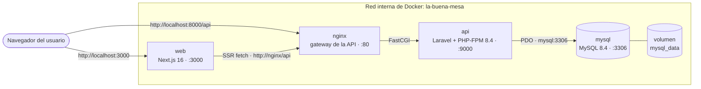

# 🍽️ La Buena Mesa — Proyecto Full-Stack dockerizado

Sistema de gestión gastronómica compuesto por una **API RESTful en Laravel 12** y un **frontend en Next.js 16**, orquestados con **Docker Compose** junto a **MySQL 8.4** y **nginx**.

El dominio del negocio gira en torno a cuatro entidades relacionadas entre sí:

- **Sucursales** — locales del restaurante.
- **Categorías** — clasificación de los ítems (entradas, bebidas, postres…).
- **Ítems** — platillos y bebidas, con precio y categoría.
- **Menús** — combinaciones de ítems para una sucursal (relación **muchos a muchos** a través de la tabla pivote `menu_item`).

| Capa | Tecnología | Puerto host |
| --- | --- | --- |
| Frontend | Next.js 16 · React 19 · TypeScript · Tailwind CSS 4 | `3000` |
| API | Laravel 12 · PHP 8.4 FPM | `8000` (vía nginx) |
| Base de datos | MySQL 8.4 | `3307` |

---

## 📦 Estructura del repositorio

```text
LaBuenaMesaAPI-RESTful/
├── api/                      # Código fuente de la API Laravel
│   ├── app/
│   │   ├── Http/Controllers/ # CategoriaController, ItemController, MenuController
│   │   ├── Http/Requests/    # ItemRequest, MenuRequest (validación)
│   │   └── Models/           # Categoria, Item, Menu, Sucursal
│   ├── database/
│   │   ├── migrations/       # Tablas + tabla pivote menu_item
│   │   ├── factories/
│   │   └── seeders/          # Datos de ejemplo (categorías, ítems, menús, sucursales)
│   ├── docker/
│   │   ├── entrypoint.sh     # Espera MySQL → migra → siembra → arranca PHP-FPM
│   │   └── nginx.conf        # Proxy FastCGI hacia api:9000
│   ├── public/
│   ├── routes/api.php
│   ├── Dockerfile            # PHP 8.4 FPM (Alpine)
│   └── Dockerfile.nginx      # nginx como entrada HTTP de la API
│
├── web/                      # Código fuente del frontend Next.js
│   ├── src/app/              # App Router: /, /items, /menus, /items/[id]…
│   ├── src/components/       # Componentes de UI
│   ├── src/lib/api.ts        # Cliente HTTP hacia la API
│   └── Dockerfile            # Build multi-stage de Next.js
│
├── docker-compose.yml        # Orquesta los 4 servicios
├── .env.example              # Variables documentadas (copiar a .env)
├── .gitignore
└── README.md
```

---

## 🏗️ Arquitectura de contenedores



**Cómo leerlo:**

1. El navegador entra por **dos puertas distintas**: `:3000` para la interfaz y `:8000` para la API (por si quieres probarla con Postman).
2. El frontend **no habla con Laravel directamente**: dentro de la red de Docker lo hace contra `http://nginx/api` (los *Server Components* de Next renderizan en el servidor, no en el navegador).
3. **nginx** sirve los archivos estáticos de `public/` y pasa las peticiones `.php` a **PHP-FPM** por FastCGI en `api:9000`.
4. **Laravel** se conecta a **MySQL** con PDO en `mysql:3306` (nombre del servicio, no `localhost`).
5. Los datos sobreviven a los reinicios porque viven en el **volumen `mysql_data`**.
6. `api` no publica puertos al host: solo es alcanzable dentro de la red, lo que reduce la superficie expuesta.

### Servicios

| Servicio | Imagen / build | Contenedor | Puerto host | Rol |
| --- | --- | --- | --- | --- |
| `web` | `./web` (Dockerfile) | `la-buena-mesa-web` | `3000` | UI Next.js |
| `nginx` | `./api` (Dockerfile.nginx) | `la-buena-mesa-nginx` | `8000` | Entrada HTTP de la API |
| `api` | `./api` (Dockerfile) | `la-buena-mesa-api` | — (interno `9000`) | Laravel + PHP-FPM |
| `mysql` | `mysql:8.4` | `la-buena-mesa-mysql` | `3307` | Base de datos |

---

## ✅ Requisitos previos

- **Docker Desktop** (incluye `docker compose`) en ejecución.
- **Git** para clonar el repositorio.
- Opcional: **PHP 8.3+** y **Composer** solo si quieres ejecutar la API sin Docker.
- Opcional: **Postman / Insomnia / Thunder Client** para probar los endpoints.

---

## 🚀 Puesta en marcha

```bash
# 1. Clonar el repositorio
git clone https://github.com/Diego-OLA/LaBuenaMesaAPI-RESTful.git
cd LaBuenaMesaAPI-RESTful

# 2. Crear el archivo de variables de entorno
cp .env.example .env        # Windows PowerShell: Copy-Item .env.example .env

# 3. Construir las imágenes y levantar los 4 servicios
docker compose up --build
```

Cuando termine el arranque:

| Recurso | URL |
| --- | --- |
| 🖥️ Frontend | <http://localhost:3000> |
| 🔌 API (JSON) | <http://localhost:8000/api/items> |
| 🗄️ MySQL (cliente externo) | `127.0.0.1:3307` |

> El primer arranque tarda unos minutos: descarga imágenes, instala dependencias de Composer y npm, compila el frontend y crea la base de datos.

### ¿Qué ocurre en el primer arranque?

1. **MySQL** crea la base `la_buena_mesa` y el usuario `labuena`, guardando los datos en el volumen `mysql_data`.
2. El **healthcheck** de MySQL (`mysqladmin ping`) marca el servicio como *healthy*.
3. El `entrypoint.sh` de la API **espera** a que la base responda.
4. Ejecuta `php artisan migrate --force`.
5. Ejecuta `php artisan db:seed --force` **solo si la base está vacía**, cargando categorías, ítems, menús y sucursales de ejemplo.
6. Arranca **PHP-FPM**; **nginx** queda escuchando en `:8000` y **Next.js** en `:3000`.

### Comandos habituales

```bash
docker compose ps                    # estado de los contenedores
docker compose logs -f               # logs de todos los servicios
docker compose logs -f api           # solo la API (migraciones, seeders)
docker compose logs -f web           # solo el frontend
docker compose down                  # detener y eliminar contenedores
docker compose down -v               # detener y BORRAR la base de datos
docker compose up --build            # reconstruir imágenes tras cambiar código
```

Para reiniciar la base de datos desde cero:

```bash
docker compose down -v
docker compose up --build
```

---

## 🔧 Variables de entorno

Todas están documentadas en [`.env.example`](.env.example). Las principales:

| Variable | Por defecto | Descripción |
| --- | --- | --- |
| `MYSQL_DATABASE` | `la_buena_mesa` | Base de datos creada por el contenedor de MySQL |
| `MYSQL_USER` | `labuena` | Usuario de aplicación |
| `MYSQL_PASSWORD` | `labuena_secret` | Contraseña del usuario |
| `MYSQL_ROOT_PASSWORD` | `root_secret` | Contraseña de root (administración) |
| `APP_KEY` | clave de desarrollo | Clave de cifrado de Laravel. **Cámbiala en producción** |
| `APP_URL` | `http://localhost:8000` | URL pública de la API |
| `NEXT_PUBLIC_API_URL` | `http://localhost:8000/api` | URL que usa el **navegador** para llamar a la API |

> **Las dos URLs de la API.** El frontend usa `API_URL` (Server Components, dentro de Docker → `http://nginx/api`) y `NEXT_PUBLIC_API_URL` (navegador → `http://localhost:8000/api`). `localhost` dentro de un contenedor apunta al propio contenedor, no a la máquina host: confundirlas es el error más habitual.

Genera una `APP_KEY` propia con:

```bash
docker compose exec api php artisan key:generate --show
```

---

## 🔌 Uso de la API

Base: `http://localhost:8000/api`

| Método | Endpoint | Descripción |
| --- | --- | --- |
| `GET` | `/items` | Lista paginada de ítems (20 por página) con su categoría y menús |
| `GET` | `/items/{id}` | Detalle de un ítem |
| `POST` | `/items` | Crear ítem |
| `PUT` | `/items/{id}` | Actualizar ítem |
| `DELETE` | `/items/{id}` | Eliminar ítem (409 si está asociado a un menú) |
| `GET` | `/categorias` | Lista de categorías |
| `GET` | `/menu-items` | Lista de menús con sus ítems |
| `GET` | `/menu-items/{id}` | Detalle de un menú |
| `POST` | `/menu-items` | Crear menú con múltiples ítems |
| `PUT` | `/menu-items/{id}` | Actualizar menú |
| `DELETE` | `/menu-items/{id}` | Eliminar menú |

### Crear un ítem

```bash
curl -X POST http://localhost:8000/api/items \
  -H "Content-Type: application/json" \
  -H "Accept: application/json" \
  -d '{
        "nombre": "Tacos al pastor",
        "descripcion": "Orden de 5 tacos con piña",
        "precio": 85.50,
        "categoria_id": 1
      }'
```

### Crear un menú (relación muchos a muchos)

```bash
curl -X POST http://localhost:8000/api/menu-items \
  -H "Content-Type: application/json" \
  -H "Accept: application/json" \
  -d '{
        "nombre": "Menú Ejecutivo de Almuerzo",
        "sucursal_id": 1,
        "items": [1, 3, 5]
      }'
```

Los IDs disponibles se consultan en `GET /api/items` y `GET /api/categorias` (vienen de los seeders).

---

## 🖥️ Frontend

Aplicación Next.js 16 (App Router) dentro de `web/`, con Tailwind CSS 4.

| Ruta | Pantalla |
| --- | --- |
| `/` | Inicio |
| `/items` | Listado paginado de ítems |
| `/items/new` | Alta de ítem |
| `/items/[id]` | Detalle |
| `/items/[id]/edit` | Edición |
| `/menus` | Listado de menús |

El cliente HTTP está en `web/src/lib/api.ts` y consume la API mediante las variables `API_URL` / `NEXT_PUBLIC_API_URL`.

Desarrollo del frontend fuera de Docker:

```bash
cd web
npm install
npm run dev          # http://localhost:3000
```

---

## 🧑‍💻 Ejecución local sin Docker (solo API)

Requiere PHP 8.3+, Composer y un MySQL/MariaDB accesible.

```bash
cd api
composer install
cp .env.example .env
php artisan key:generate
php artisan migrate --seed
php artisan serve    # http://127.0.0.1:8000
```

---

## 🗄️ Conexión externa a MySQL

Para revisar la base con DBeaver, TablePlus o MySQL Workbench:

| Parámetro | Valor |
| --- | --- |
| Host | `127.0.0.1` |
| Puerto | `3307` |
| Base de datos | `la_buena_mesa` |
| Usuario | `labuena` |
| Contraseña | `labuena_secret` |

Se usa el puerto **3307** para no chocar con un MySQL local (WAMP/XAMPP suelen ocupar el 3306).

---

## 🩺 Solución de problemas

| Síntoma | Causa probable | Solución |
| --- | --- | --- |
| `502 Bad Gateway` en `:8000` | PHP-FPM aún arrancando o migrando | `docker compose logs -f api` |
| La web muestra error al cargar datos | La API no responde para el navegador | Comprueba `http://localhost:8000/api/items` y `NEXT_PUBLIC_API_URL` |
| `Connection refused` a MySQL | El contenedor de MySQL no está *healthy* | `docker compose ps` y espera al healthcheck |
| Cambios en el código no se reflejan | La imagen está cacheada | `docker compose up --build` |
| Puerto ocupado (`8000`, `3000` o `3307`) | Otro proceso lo usa | Cambia el mapeo en `docker-compose.yml` |
| Los seeders no vuelven a ejecutarse | Solo corren con la base vacía | `docker compose down -v && docker compose up --build` |

---

## 🧰 Stack técnico

**Backend:** Laravel 12 · PHP 8.4 · MySQL 8.4 · Laravel Sanctum · PHPUnit
**Frontend:** Next.js 16 · React 19 · TypeScript · Tailwind CSS 4 · ESLint
**Infraestructura:** Docker · Docker Compose · nginx · Alpine Linux
